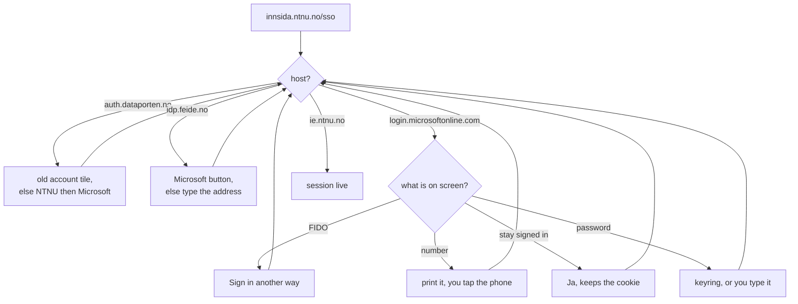

# ntnu-studass-apply

The studass portal at https://ie.ntnu.no/studass/ takes one application per listing, and a
round has a few dozen listings. This fills that form from the shell instead, in whatever
order I decided beforehand.

## VPN first

ie.ntnu.no only answers NTNU addresses. From Cape Town on 21.10.2026 it replied to ping at
182 ms and never completed TCP to 443.

    openconnect --protocol=anyconnect vpn.ntnu.no

`preflight` checks that. Every other command quits if the tunnel is down.

## Setup

    python3 -m venv .venv
    .venv/bin/pip install -r requirements.txt
    .venv/bin/playwright install chromium

## Commands

    ./studass.py preflight
    ./studass.py login                                      # headed, Feide once
    ./studass.py dump                                       # page HTML into out/raw/
    ./studass.py list --campus trondheim
    ./studass.py apply --all --campus trondheim             # dry run
    ./studass.py apply --all --campus trondheim --submit
    ./studass.py apply --all --exclude IDATT2105 --submit
    ./studass.py apply --only IDATT2106,TDT4114 --submit
    ./studass.py status
    ./studass.py profile --laos ~/laos.pdf

## Login

`login` opens a real window and clicks through Feide and Entra by watching which host the
page lands on, not by following a fixed script. Feide likes to reorder that chain.



It waits ten minutes, since the phone tap is yours. The Chromium profile sits in
`~/.local/share/studass/profile`, so the next round usually wants the tap and little else.

User defaults to `trile@stud.ntnu.no`, override with `--user` or `NTNU_USER`. Password comes
from `NTNU_PASSWORD_FILE`, then the keyring, then `NTNU_PASSWORD`, and otherwise the window
waits for you to type it. To stop typing it:

    secret-tool store --label="NTNU Feide" service studass username trile@stud.ntnu.no

## Order

Listings come off the portal's own dropdown. TEST entries go, Gjøvik goes under
`--campus trondheim`, `--only` and `--exclude` do the rest. What is left sorts by
`priority.txt` in the order you wrote it, then by institute prefix:

| Bucket | Prefixes |
|---|---|
| 1 | TDT IT DCST DIFT ITO IDI IDATT |
| 2 | TTM IIK IIKT |
| 3 | TTK |
| 4 | MA TMA IMAT IMAG TFOR |
| 5 | the rest, alphabetical |

Submission order is the priority, and you can reshuffle in the portal until the deadline.

## Submitting

Without `--submit` it prints the plan and the comment, then stops. With it, each listing gets
a freshly loaded form, and a submit only counts when the portal confirms twice.

```mermaid
flowchart TD
    start["next listing"] --> load["reload form,<br/>find select, comment, submit"]
    load --> gone{"still offered?"}
    gone -->|no| skip["someone took it, skip"]
    gone -->|yes| fill["select, paste comment.txt,<br/>tick eula"]
    fill --> click["submit, wait for reload"]
    click --> check{"dropped from the dropdown<br/>AND Aktive søknader grew?"}
    check -->|yes| ok["registered"]
    check -->|no| shot["screenshot to out/screenshots/,<br/>exit 4 at the end"]
    skip --> start
    ok --> start
    shot --> start
```

Anything already in Aktive søknader never enters the plan, so rerunning a half finished round
is safe.

## Two refusals

It will not type a personnummer. `profile --laos` uploads the kursbevis and stops there, and
if the portal rejects the save over an empty personnummer field it tells you instead of
filling it.

It will not hold a password. It reads the one you put in the keyring. `dump` also scrubs
before writing: eleven digit numbers become REDACTED, as does the value of any input named
like a fødselsnummer field.

## Files

- `comment.txt` goes into every application
- `priority.txt` course codes, strongest first, `#` comments fine
- `out/` dumps, JSON and failure screenshots, gitignored

## Exit codes

| Code | Meaning |
|---|---|
| 0 | fine |
| 2 | no session, run `login` |
| 3 | spring round not open |
| 4 | a submit went unconfirmed |
| 5 | portal unreachable, check the VPN |
